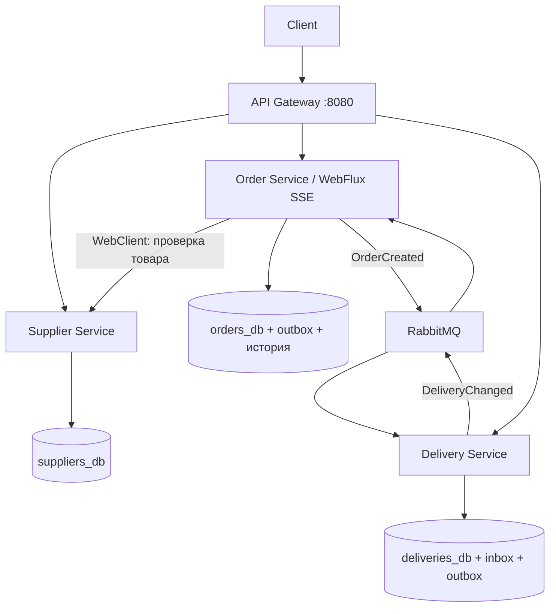

# Практическая работа №8: поставщики, заказы и доставка

Java 21, Spring Boot 3.5.7, WebFlux, WebClient, Resilience4j, RabbitMQ, PostgreSQL.
Четыре независимых Spring Boot приложения и три отдельных экземпляра PostgreSQL.
Модуль common — библиотека формата событий и инфраструктуры, без доступа к чужим данным.

## Запуск

Нужен Docker Desktop в режиме Linux containers и Docker Compose 2.20+.
Локальные Java/Maven для запуска не нужны.

В каталоге PW8 (или на уровень выше через include-файл):

```powershell
docker compose up --build -d
docker compose ps
Invoke-RestMethod http://localhost:8080/api/health | ConvertTo-Json -Depth 10
```

Обычный `docker compose up` также собирает отсутствующие образы и запускает все компоненты.
Первая сборка загружает Maven-зависимости и Docker-образы.
Клиентский порт — 8080, консоль RabbitMQ — [localhost:15672](http://localhost:15672)
(пользователь pw8, пароль pw8-local). Пароли в Compose предназначены для локальной учебной демонстрации.
Порты бизнес-сервисов и баз не опубликованы на хосте.



Traefik не требуется заданием и здесь не используется. Gateway реализован на WebFlux:
маршрутизирует HTTP и передаёт SSE без накопления всего ответа в памяти.

## API и ручная демонстрация

Все пользовательские запросы проходят через Gateway по адресу `http://localhost:8080`.
Запросы можно выполнить в Postman, Insomnia или PowerShell после запуска Docker Compose.
Для всех GET-запросов тело не требуется. Для POST и PATCH ниже приведены JSON-тела;
укажите заголовок `Content-Type: application/json`.

| Метод | Полный URL | Назначение |
|---|---|---|
| GET | `http://localhost:8080/api/suppliers` | Поставщики |
| GET | `http://localhost:8080/api/suppliers/products` | Товары |
| GET | `http://localhost:8080/api/suppliers/products/1` | Карточка товара с id = 1 |
| POST | `http://localhost:8080/api/orders` | Создать заказ; тело приведено ниже |
| GET | `http://localhost:8080/api/orders` | Заказы |
| GET | `http://localhost:8080/api/orders/{orderId}` | Заказ и текущий статус |
| GET | `http://localhost:8080/api/orders/{orderId}/events` | SSE: история и новые статусы |
| GET | `http://localhost:8080/api/orders/resilience` | Состояние Circuit Breaker |
| GET | `http://localhost:8080/api/deliveries` | Доставки |
| GET | `http://localhost:8080/api/deliveries/by-order/{orderId}` | Доставка заказа |
| PATCH | `http://localhost:8080/api/deliveries/by-order/{orderId}/status` | Новый статус доставки; тела приведены ниже |
| GET | `http://localhost:8080/api/health` | Gateway и состояние всех бизнес-сервисов с их DB/RabbitMQ |
| GET | `http://localhost:8080/actuator/health` | Состояние Gateway |

`{orderId}` замените на значение поля `id` из ответа на создание заказа, без фигурных скобок.
В путях доставки также используется идентификатор **заказа**, а не поле `id` доставки.
Например, если заказ получил id `550e8400-e29b-41d4-a716-446655440000`, запрос его состояния:

```http
GET http://localhost:8080/api/orders/550e8400-e29b-41d4-a716-446655440000
X-Request-ID: defense-8
```

### Создание заказа

```http
POST http://localhost:8080/api/orders
Content-Type: application/json
X-Request-ID: defense-8

{
  "productId": 1,
  "quantity": 1,
  "address": "Москва, ул. Примерная, 8"
}
```

Ожидаемый код ответа — `201 Created`. Сохраните поле `id` ответа для дальнейших запросов.
`productId` — положительный идентификатор товара, `quantity` — целое число от 1 до 1000,
`address` — непустой адрес длиной не более 500 символов.

### Изменение статуса доставки

Дождитесь появления доставки: запрос
`GET http://localhost:8080/api/deliveries/by-order/{orderId}` должен вернуть `200 OK`.
Сразу после создания заказа возможен `404`, пока событие ещё обрабатывается; повторите GET через секунду.

Сначала переведите доставку в путь:

```http
PATCH http://localhost:8080/api/deliveries/by-order/{orderId}/status
Content-Type: application/json
X-Request-ID: defense-8

{
  "status": "IN_TRANSIT"
}
```

Затем отметьте доставку завершённой:

```http
PATCH http://localhost:8080/api/deliveries/by-order/{orderId}/status
Content-Type: application/json
X-Request-ID: defense-8

{
  "status": "DELIVERED"
}
```

Оба PATCH-запроса возвращают `200 OK` и актуальную доставку.
Тело содержит только поле `status`; допустимы значения `IN_TRANSIT` и `DELIVERED`.
Статус заказа обновляется асинхронно: проверьте его через
`GET http://localhost:8080/api/orders/{orderId}` или SSE.

### Подписка на статусы заказа

Откройте подписку перед изменением статусов доставки. Тело запроса не требуется.

```http
GET http://localhost:8080/api/orders/{orderId}/events
Accept: text/event-stream
X-Request-ID: defense-8
```

Для возобновления подписки добавьте `Last-Event-ID` с последним полученным значением
поля `id:` из SSE-потока. Например, если последним было событие с id `2`:

```http
GET http://localhost:8080/api/orders/{orderId}/events
Accept: text/event-stream
X-Request-ID: defense-8
Last-Event-ID: 2
```

SSE-id — номер события, он отличается от UUID заказа.

### Проверка состояния компонентов

Внутри каждого контейнера доступны `/actuator/health`, `/actuator/health/liveness`,
`/actuator/health/readiness`. Compose healthcheck проверяет liveness.
Зависимости проверяет полная health-информация, агрегированная в /api/health:
UP, DOWN или UNAVAILABLE. HTTP 200 агрегатора означает, что сама проверка выполнена;
доступность компонентов определяется по полям результата.

Предзаполнены товары: 1 — ноутбук (65000 руб., доступно 20), 2 — мышь (1500 руб., доступно 100).
Проверяется доступность выбранного количества. Учебный сценарий не резервирует и не списывает остатки:
это потребовало бы отдельного сценария резервирования и компенсации.

### Сквозная демонстрация в PowerShell

Автоматический сценарий (компоненты должны быть уже запущены через Compose):

```powershell
./scripts/demo.ps1
./scripts/demo.ps1 -IncludeFailureDemo
```

Ручной сценарий в PowerShell:

```powershell
$headers = @{ 'X-Request-ID' = 'defense-8' }
$body = @{ productId = 1; quantity = 1; address = 'Москва, ул. Примерная, 8' } | ConvertTo-Json
$order = Invoke-RestMethod -Method Post -Uri http://localhost:8080/api/orders -Headers $headers -ContentType 'application/json; charset=utf-8' -Body ([Text.Encoding]::UTF8.GetBytes($body))
$order
$id = $order.id
```

В другом терминале открыть SSE, подставив полученный id:

```powershell
curl.exe -N -H "X-Request-ID: defense-8" http://localhost:8080/api/orders/ORDER_ID/events
```

Подписка сначала отдаёт сохранённую историю, затем новые события:
CREATED → DELIVERY_CREATED → IN_TRANSIT → DELIVERED.
Пустой комментарий keepalive отправляется раз в 10 секунд.
При переподключении заголовок `Last-Event-ID` содержит последний полученный SSE id:
будут возвращены только более новые события. История хранится в DB, поэтому рестарт Order Service
не теряет статусы. Статусы выдаются через `Flux<ServerSentEvent<...>>`,
HTTP-запросы используют Mono. Блокирующий JDBC вынесен в boundedElastic.

После асинхронного создания доставки выполнить:

```powershell
Invoke-RestMethod "http://localhost:8080/api/deliveries/by-order/$id"
Invoke-RestMethod -Method Patch -Uri "http://localhost:8080/api/deliveries/by-order/$id/status" -Headers $headers -ContentType application/json -Body '{"status":"IN_TRANSIT"}'
Invoke-RestMethod -Method Patch -Uri "http://localhost:8080/api/deliveries/by-order/$id/status" -Headers $headers -ContentType application/json -Body '{"status":"DELIVERED"}'
```

Переходы только последовательные; неправильный переход получает 409.
Повтор установки текущего статуса возвращает текущую доставку и не публикует новое событие.
Пустой адрес, некорректное количество или статус — 400; отсутствующий товар — 404;
недостаточное количество — 409; недоступный поставщик — 503.

Логи одного сценария:

```powershell
docker compose logs api-gateway order-service supplier-service delivery-service | Select-String 'defense-8'
```

X-Request-ID проходит Gateway → Order → Supplier и сохраняется в OrderCreated →
DeliveryChanged. В PATCH следует передавать тот же идентификатор, чтобы объединить
ручную демонстрацию; иначе новый пользовательский запрос получает новый идентификатор.
Gateway и сервисы проверяют формат заголовка и при необходимости генерируют UUID.
Идентификатор также возвращается в HTTP-ответах.

## Демонстрация отказа и восстановления

```powershell
docker compose stop supplier-service
Invoke-RestMethod http://localhost:8080/api/health | ConvertTo-Json -Depth 10
```

Повторите POST /api/orders: получите контролируемый JSON-ответ 503, заказ не создаётся.
Для открытия Circuit Breaker выполните несколько запросов и проверьте:

```powershell
Invoke-RestMethod http://localhost:8080/api/orders/resilience
docker compose start supplier-service
```

WebClient: connect timeout 1 секунда, timeout каждой попытки 2 секунды,
одна повторная попытка с паузой 200 мс только для сетевых ошибок, тайм-аута и HTTP 5xx.
Таким образом, обращение к поставщику ограничено примерно 4.2 секундами плюс локальная обработка.
HTTP 404 и прочие клиентские ошибки не повторяются.
Resilience4j учитывает результат всей операции с повтором:
окно 4 обращения, минимум 4, порог отказов 50%, OPEN 10 секунд,
после этого до двух проб в HALF_OPEN. После успешных проб возвращается CLOSED.
Сразу после восстановления сервис может ещё получать 503 до окончания OPEN-периода.

В Gateway есть connect timeout 1 секунда и response timeout 15 секунд,
включая ожидание данных потока. SSE keepalive раз в 10 секунд сохраняет подписку.
Ошибки соединения с внутренним сервисом превращаются в 503.
SSE-подписку после рестарта сервиса необходимо открыть заново с Last-Event-ID.

Для проверки асинхронного сценария:

1. Остановить delivery-service и создать заказ: заказ остаётся CREATED, событие ждёт в durable queue.
2. Запустить delivery-service: создаётся доставка, заказ получает DELIVERY_CREATED.
3. Остановить rabbitmq и создать заказ: заказ и outbox остаются в DB; /api/health покажет отказ брокера.
4. Запустить rabbitmq: планировщик повторно опубликует outbox, потребители возобновят обработку.

## Надёжность сообщений

Order и OrderCreated записываются в одной DB-транзакции (Transactional Outbox).
Создание/изменение Delivery и DeliveryChanged также записываются одной транзакцией.
Планировщик читает outbox с FOR UPDATE SKIP LOCKED, отправляет persistent-сообщения
в durable exchange/queue и удаляет запись только после publisher confirm,
при этом mandatory/returns проверяет, что сообщение было маршрутизировано.
Если процесс завершился между публикацией и коммитом, сообщение может быть отправлено повторно.

Delivery хранит inbox с PRIMARY KEY(event_id) и UNIQUE(order_id).
Повтор того же сообщения и другое событие о том же заказе не создают вторую доставку.
Inbox, доставка и outbox фиксируются совместно; сбой приводит к откату всей транзакции.
Order также хранит inbox и обновляет статус под блокировкой строки;
version защищает от запоздалых событий и отката статуса назад.
При перестановке сообщений история может пропустить промежуточный статус, но текущий статус не регрессирует.

Ошибки потребителя повторяются до 5 попыток с задержкой 1–5 секунд, затем сообщение
попадает в business.dead.queue для разбора, вместо бесконечного цикла обработки.
Автоматического удаления/повторной отправки dead-letter сообщений нет.
Обработка at-least-once; идемпотентность достигается ограничениями DB и inbox.

OrderCreated содержит eventId, type, orderId, address, status, version и requestId;
товары и личные данные поставщика не передаются. DeliveryChanged не содержит адреса.
Каждый сервис знает только URL чужого API или контракт события, но не учётные данные чужой DB.

## Проверки

```powershell
mvn -B package
docker compose config --quiet
./scripts/demo.ps1 -IncludeFailureDemo
```

Для Maven нужен JDK 21+. Автоматические тесты проверяют атомарность заказа/outbox,
идемпотентность доставки, откат при ошибке, переходы статусов, старые/повторные события,
retry, отсутствие retry на 404, открытие Circuit Breaker и ограничение времени ожидания.
Тесты DB используют H2 в PostgreSQL mode; окончательная интеграционная проверка PostgreSQL/RabbitMQ
выполняется скриптом на Compose-окружении. Dockerfile собирает приложения внутри Maven-контейнера.

## Соответствие заданию

| Требование | Реализация |
|---|---|
| 3 бизнес-сервиса | supplier-service, order-service, delivery-service |
| Отдельные приложения и данные | 4 JAR, 3 PostgreSQL, отдельные credentials |
| API Gateway | WebFlux proxy, единственный опубликованный бизнес-порт |
| Синхронный HTTP | Order → Supplier через WebClient |
| Брокер | RabbitMQ, OrderCreated и DeliveryChanged |
| Идемпотентность | inbox, UNIQUE order_id, версии статусов |
| Timeout/retry/Circuit Breaker | SupplierClient + Resilience4j |
| Docker Compose | приложения, 3 DB, брокер, healthchecks, volumes |
| Состояние компонентов | Actuator + /api/health |
| Трассировка | X-Request-ID в HTTP, сообщениях и логах |
| WebFlux/Mono/Flux | реактивные REST и SSE, история из DB |
| Сквозной сценарий/отказ | scripts/demo.ps1 и команды выше |

Остановка: `docker compose down`. Данные сохраняются в volumes.
